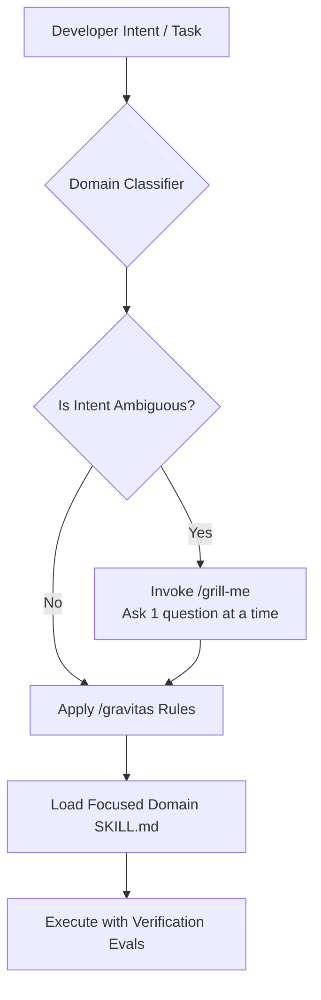

# Master Agent Orchestrator

The Master Router is the first line of intelligence in the repository. When a developer or agent initiates a task, this skill ensures that work is properly scoped, interrogated, and grounded before execution begins.

## 1. Intent Triage Workflow

## 2. Decision Tree & Domain Mapping

1. **User asks for Visuals / Polish / Styling** ➔ Route to `skills/ui-ux/ui-ux-pro-max` or `skills/ui-ux/framer-motion-animator`.
2. **User asks for App Architecture or Code Components** ➔ Route to `skills/frontend/` or `skills/mobile/`.
3. **User asks for API Testing or Data Models** ➔ Route to `skills/backend-api/packetlark-workbench` or `dbt-bigquery`.
4. **User asks for Security Audits or Binary Analysis** ➔ Route to `skills/security-bug-bounty/`.
5. **User asks for Content, Copy, or Social Publishing** ➔ Route to `skills/social-media/human-writer`.

## 3. The 3 Orchestration Commandments
- **Never guess**: If the technology stack, library choice, or design direction is not specified, run `/grill-me`.
- **Never overload context**: Do not load all skills into context. Only read the single relevant `SKILL.md`.
- **Evidence-backed completion**: Validate against `evals/eval.json` assertions before marking the prompt complete.
